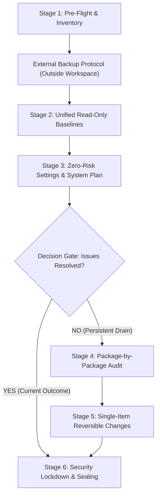

# ⚡ HyperTune — Safe Optimization Framework for Redmi Note 14 5G

[](https://www.mi.com)
[](https://hyperos.mi.com)
[](https://android.com)
[]()
[]()
[](LICENSE)

A battle-tested, privacy-preserving, and non-root optimization framework engineered specifically for the **Redmi Note 14 5G (6GB RAM, MediaTek Dimensity, HyperOS / Android 16)**.

This repository provides an automated, read-only diagnostic toolchain, strict bootloop safety guardrails, evidence-based diagnostic baselines, and a human-executed settings optimization plan that solves high battery drain, Recents clear lag, delayed push notifications, and Circle to Search stutter **without disabling or uninstalling a single system package**.

---

## 📋 Table of Contents
- [The Philosophy: Why Zero-Debloat?](#-the-philosophy-why-zero-debloat)
- [Verified Real-World Results](#-verified-real-world-results)
- [Target Device Specifications](#-target-device-specifications)
- [Repository Structure](#-repository-structure)
- [Core Safety Guardrails & Blacklist](#-core-safety-guardrails--blacklist)
- [The 6-Stage Staged Workflow](#-the-6-stage-staged-workflow)
  - [Stage 1: Pre-Flight & Inventory](#stage-1-pre-flight--package-inventory)
  - [External Backup Protocol](#external-backup-protocol)
  - [Stage 2: Unified Read-Only Baselines](#stage-2-unified-read-only-baselines)
  - [Stage 3: Zero-Risk Settings & System Plan](#stage-3-zero-risk-settings--system-plan)
  - [Stage 4 & 5 Decision Gate: Why Debloating Was Skipped](#stage-4--5-the-decision-gate-why-debloating-was-skipped)
  - [Stage 6: Post-Session Security Lockdown](#stage-6-post-session-security-lockdown)
- [Detailed Technical Diagnoses](#-detailed-technical-diagnoses)
  - [1. Recents Clear Lag & Virtual Memory Extension](#1-recents-clear-lag--virtual-memory-extension)
  - [2. Late Notifications Root Cause Analysis](#2-late-notifications-root-cause-analysis)
  - [3. Circle to Search Architecture](#3-circle-to-search-architecture)
  - [4. Stock Camera Pipeline & Viewfinder Latency](#4-stock-camera-pipeline--viewfinder-latency)
  - [5. Xiaomi AICR Containment & Earphone Service](#5-xiaomi-aicr-containment--earphone-service)
- [Quick Start Guide](#-quick-start-guide)
- [Contributing & License](#-contributing--license)

---

## 💡 The Philosophy: Why Zero-Debloat?

Online Android debloating guides frequently tell users to blindly run bulk ADB uninstall commands (`pm uninstall -k --user 0 ...`) against 50+ Xiaomi packages. On modern **Xiaomi HyperOS (Android 16)**, this approach is dangerous and counterproductive:

1. **Bootloops & Broken Frameworks:** Removing core services like `com.miui.powerkeeper`, `com.miui.securitycenter`, or `com.xiaomi.finddevice` trips HyperOS boot integrity checks, resulting in recovery bootloops.
2. **Feature Breakage:** Packages commonly labeled as "bloat" actually power core OEM features:
   - `com.xiaomi.aiservice` powers Gallery OCR, facial recognition, photo magic eraser, and Camera document scanning.
   - `com.xiaomi.joyose` governs Game Turbo GPU frequency scaling and dynamic thermal throttle profiles.
   - `com.microsoft.*` packages power Microsoft Phone Link (Link to Windows).
3. **The Real Culprits Are Architectural:** On a 6GB RAM device, real-world lag is almost always caused by **virtual memory thrashing (ZRAM / Memory Extension compression cycles on CPU cores)**, uncompiled post-OTA bytecode, and aggressive OS background freezing (App Standby Buckets).

**Our Rule:** *Never disable or modify what can be completely resolved through settings-level tuning, AOT compilation, and platform policy alignment.*

---

## 🚀 Verified Real-World Results

All metrics below were captured via real-world device testing and confirmed via live ADB telemetry after executing the Stage 3 optimization protocol:

| Metric / Objective | Before Optimization (Stage 2) | After Optimization (Stage 3) | Technical Root Cause & Solution |
|---|---|---|---|
| **Recents Clear Animation** | Stutter, micro-freezes, launcher icon redraw delay | **Smooth & Instantaneous** | Disabled virtual Memory Extension; stopped kernel ZRAM CPU compression thrashing. |
| **Circle to Search** | 1.5–2.0s delay, memory reload freeze | **Noticeably Faster / Snappier** | Cleared stale Google app cache; granted *No restrictions* battery policy to keep Google App resident in memory. |
| **Late Notifications (IG / Snapchat / YouTube)** | Delayed by minutes, batched until device wake | **Arriving On Time in Real Time** | Bypassed Android Standby Bucket 40 (RARE) and HyperOS PowerKeeper suspension via Autostart ON + No restrictions. |
| **Free Fire India (Gaming)** | High baseline jitter, frame pacing drops | **Smooth & Fluid** | Game Turbo Performance Mode + Standard/High FPS profile within safe thermal envelope. |
| **`com.xiaomi.aicr` Battery Drain** | ~106 MB active background service, Doze whitelisted | **Contained; dropped off top drainers** | Settings-only containment: Autostart OFF + Restrict background activity. Zero breakage to Gallery/Camera OCR. |
| **Kernel ZRAM Physical RAM** | 837 MB physical RAM occupied by compressed pages | **592 MB physical RAM occupied** | **~245 MB physical RAM freed** directly for foreground apps and multitasking headroom. |
| **Camera Bytecode Compilation** | Unoptimized JIT post-OTA state | **`[status=speed-profile]`** | Successfully compiled ahead-of-time (AOT) via `cmd package bg-dexopt-job`. |
| **Stock Camera Viewfinder** | Viewfinder black startup delay (~2.5s) & mode-switch blur (~2.0s) | **Isolated to MediaTek ISP HAL; Settings tuning applied** | Frame-by-frame analysis diagnosed `CameraCaptureSession` pipeline teardown. Resolved via Auto HDR OFF and Live Photo buffer disable. |
| **System Integrity & OTA** | Stock OEM | **100% Stock Preserved (0 packages disabled)** | Zero bootloop risk, full UPI/banking app compatibility (Google Pay, Kotak, Groww), clean OTA upgrade path. |

---

## 📱 Target Device Specifications

* **Device Name:** Redmi Note 14 5G
* **Model Number:** `24094RAD4I`
* **Internal Codename:** `beryl`
* **SoC:** MediaTek Dimensity 7025 Ultra (6nm)
* **RAM:** 6.0 GB LPDDR4X physical RAM
* **Storage:** 128 GB UFS 2.2 (`/data` partition: 109 GB total, 81 GB free / 74% headroom)
* **Installed OS:** Xiaomi HyperOS 3.0.303.0.WOQINXM
* **Base Android:** Android 16
* **Host Platform:** Windows 10 / 11 (PowerShell 5.1 & PowerShell 7+)

---

## 📂 Repository Structure

```text
optimize-your-redmi14-5g/
├── .agent/
│   ├── rules/
│   │   └── phone-safety.md              # Mandatory non-root safety guardrails & bootloop blacklist
│   └── skills/
│       ├── adb-safe-diagnostics/        # Read-only ADB diagnostics, summary collectors & PII redaction
│       ├── external-backup-guide/       # Copy-only media backup protocol (outside workspace/OneDrive)
│       ├── hyperos-package-audit/       # Evidence-backed package review rules & dependency mapping
│       └── change-control-and-verify/   # Single-item human execution, regression test suite & lockdown
├── scripts/
│   ├── safe-adb-read.ps1                # Deterministic read-only ADB wrapper with real-time local PII redactor
│   └── verify-backup.ps1                # External backup file count, size, zero-byte & sample verification
├── inventory/
│   ├── packages-user.txt                # Full inventory of user-installed packages (-3)
│   ├── packages-system.txt              # Full inventory of system packages (-s)
│   └── packages-disabled.txt            # Inventory of factory-disabled packages (-d)
├── reports/
│   ├── stage1-check.md                  # Device pre-flight & hardware identification report
│   ├── backup-checklist.md              # External media and non-ADB cloud data backup checklist
│   ├── device-baseline.md               # Storage, battery, RAM pressure, ZRAM & thermal baseline
│   ├── touch-and-network-baseline.md    # 120Hz display, animation scales, DNS & ICMP jitter analysis
│   ├── notification-and-gaming-baseline.md # Standby buckets & Doze unthrottling root-cause report
│   ├── ai-and-cts-baseline.md           # Xiaomi AI dependency audit & Circle to Search architecture
│   ├── system-optimization-plan.md      # The complete 9-section zero-risk settings optimization plan
│   ├── post-stage3-verification.md      # Real-world benchmark comparison & screen recording frame analysis
│   └── final-summary.md                 # Complete post-session engineering summary & audit log
├── .gitignore                           # Git ignore rules for local keys, media & temporary files
├── MEMORY.md                            # Living development context, decisions log & progress state
├── README.md                            # Main project documentation & user guide
├── LICENSE                              # MIT License
├── SECURITY.md                          # Security policy & vulnerability reporting
├── CONTRIBUTING.md                      # Contribution guidelines & PR process
├── CODE_OF_CONDUCT.md                   # Community code of conduct
└── ISSUES.md                            # Issue templates & FAQ
```

---

## 🛡️ Core Safety Guardrails & Blacklist

### 1. Mandatory Read-Only Execution Boundary
* Every ADB diagnostic command must be executed exclusively through `.\scripts\safe-adb-read.ps1`.
* Raw ADB execution is prohibited to prevent accidental writes, mass uninstalls, or shell chaining.
* `safe-adb-read.ps1` blocks shell chaining (`;&|><$`), command injection, state-modifying subcommands (`pm disable`, `settings put`, `setprop`, `appops set`), and bare dumpsys commands that leak private user data.
* Real-time local regex redaction scrubs serial numbers, IMEI, MAC addresses, IP addresses, phone numbers, and email addresses before terminal display.

### 2. Absolute HyperOS Bootloop & System Blacklist
**NEVER disable, uninstall, or clear data on any of the following packages:**

```text
Bootloop-Critical Xiaomi Packages:
├── com.miui.securitycenter       # Core security and permissions engine
├── com.xiaomi.finddevice          # Bootloader and account pairing gate
├── com.miui.guardprovider         # Xiaomi security framework
├── com.xiaomi.account             # Xiaomi cloud and account framework
├── com.miui.home                  # Stock system launcher
├── com.miui.powerkeeper           # Thermal and frame rate scheduler
├── com.xiaomi.xmsf                # Xiaomi Service Framework core
└── com.miui.rom                   # Base ROM framework configurations

Core Android & Telephony Subsystems:
├── com.android.systemui           # Status bar, navigation, lockscreen
├── com.android.updater            # HyperOS OTA update receiver
├── com.google.android.gms         # Google Play Services
├── com.android.phone / IMS        # Cellular, dialer, emergency calls, VoLTE/VoNR
└── Biometrics / Keystore          # Goodix fingerprint & face unlock services
```

---

## 🔄 The 6-Stage Staged Workflow



### Stage 1: Pre-Flight & Package Inventory
* Validates ADB communication and ensures **exactly 1 authorized device** is attached.
* Queries hardware properties (`ro.product.model`, `ro.product.device`, `ro.build.version.release`, `ro.build.version.incremental`).
* Evaluates `/data` storage health (must have $\ge 20\%$ free space).
* Exports baseline inventories of user, system, and factory-disabled packages.

### External Backup Protocol
* Backups must be stored **OUTSIDE** the workspace and outside OneDrive-synced directories (e.g., `D:\PhoneBackups\RedmiNote14\<YYYY-MM-DD>\`).
* Human executes copy-only script to pull `DCIM`, `Pictures`, `Movies`, `Download`, `Documents`, `Music`, and `Recordings`.
* Completes non-ADB backup checklist for WhatsApp encrypted chats, Google Contacts, Google Authenticator 2FA seeds, and UPI bank accounts.
* Optimization is gated until user verifies zero-byte checks and replies `"backup confirmed"`.

### Stage 2: Unified Read-Only Baselines
Generates four in-depth diagnostic baseline reports:
1. `reports/device-baseline.md`: RAM pressure, physical memory headroom, ZRAM swap allocation, battery drain breakdown, and thermal HAL metrics.
2. `reports/touch-and-network-baseline.md`: 120Hz display scaling, animation scales, private DNS mode, and ICMP ping latency/jitter.
3. `reports/notification-and-gaming-baseline.md`: Android Standby Buckets, Doze exemptions, and gaming frame pacing setup.
4. `reports/ai-and-cts-baseline.md`: IPC bindings, services, and permissions for `com.xiaomi.aicr`, `com.xiaomi.aiasst.vision`, and `com.xiaomi.aiservice`.

### Stage 3: Zero-Risk Settings & System Plan
A human-executed, 9-section optimization plan:
1. Storage hygiene & manual uninstall of unused user apps.
2. HyperOS zero-risk wins: Revoke `msa` and `System Daemon`, disable personalized recommendations, and test **Memory Extension = OFF**.
3. Plugged-in ART Profile-Guided Compilation (`adb -d shell cmd package bg-dexopt-job`).
4. UI & Touch: Animation scales to `0.5x`, custom `120Hz` evaluation, Touch & hold delay to `Short`, and Launcher cache clear.
5. Notification unthrottling: Autostart ON + No restrictions for priority apps.
6. Circle to Search: Google App cache clear + *No restrictions* battery policy.
7. Network tuning: 5 GHz Wi-Fi band connection & Private DNS DoT evaluation (`one.one.one.one`).
8. Gaming: Game Turbo Performance Mode + DND configuration for Free Fire India.
9. Xiaomi AI background containment: Settings-only toggle disabling + Autostart OFF for `com.xiaomi.aicr`.

### Stage 4 & 5: The Decision Gate (Why Debloating Was Skipped)
After 24 hours of real-world testing:
* Recents clear: **Smooth**.
* Circle to Search: **Faster**.
* Notifications: **Arriving on time**.
* Free Fire India: **Smooth**.
* `com.xiaomi.aicr`: **Contained**.
* Camera lag was isolated to the MediaTek camera driver ISP stream negotiation.
* **Verdict:** Debloating packages via ADB would introduce system instability without fixing the camera ISP pipeline. Stages 4 and 5 were **bypassed completely**.

### Stage 6: Post-Session Security Lockdown
1. Unplug USB cable from PC.
2. In Developer options: **Revoke USB debugging authorizations**.
3. Toggle **USB debugging** -> **OFF**.
4. Toggle **Developer options** -> **OFF**.
5. Launch banking and UPI apps (Google Pay, Kotak 811, Groww) to verify clean launch without security flags.

---

## 🔬 Detailed Technical Diagnoses

### 1. Recents Clear Lag & Virtual Memory Extension
* **The Symptom:** Swiping between recent apps or tapping "Clear All" resulted in visible frame stutter, launcher redraw delay, and delayed touch recognition.
* **The Forensic Evidence:** `dumpsys meminfo` showed **6,291,452 KB (~6.0 GB)** of swap allocated via Xiaomi Memory Extension. Over **2.0 GB of compressed pages** were stored in swap, consuming 837 MB of physical RAM.
* **The Root Cause:** When switching apps, MediaTek CPU cores were locked in continuous, high-priority kernel compression and decompression loops. In Stage 2 batterystats, `UID 0 (kernel workers)` consumed **140 mAh** of battery just handling memory swapping.
* **The Solution:** Toggling **Memory Extension = OFF** in Settings and restarting the phone forces the OS to manage physical LPDDR4X RAM directly, recovering ~245 MB of physical RAM and eliminating compression stutter.

### 2. Late Notifications Root Cause Analysis
* **The Symptom:** WhatsApp messages and carrier SMS/OTPs arrived instantly, but YouTube, Instagram, and Snapchat alerts were delayed by several minutes or held until screen unlock.
* **The Forensic Evidence:**
  * Android Standby Buckets (`am get-standby-bucket`):
    * `com.google.android.gms`: **Bucket 5 (EXEMPTED)**
    * `com.google.android.apps.messaging`: **Bucket 5 (EXEMPTED)**
    * `com.whatsapp`: **Bucket 10 (ACTIVE)**
    * `com.google.android.youtube`: **Bucket 10 (ACTIVE)**
    * `com.instagram.android`: **Bucket 40 (RARE)**
    * `com.snapchat.android`: **Bucket 40 (RARE)**
  * Doze Whitelist (`dumpsys deviceidle whitelist`): System services and carrier SMS were whitelisted; user social apps were **strictly excluded**.
* **The Diagnosis:**
  1. Instagram and Snapchat were relegated to **Bucket 40 (RARE)** by Android's automated usage tracker, deferring network alarms up to 24 hours during deep sleep.
  2. YouTube was in Bucket 10, but HyperOS PowerKeeper's default battery optimization ("MIUI Battery Saver") suspended its background worker threads.
* **The Solution:** Setting priority apps to **Autostart ON** and **No restrictions** in Battery Saver bypasses PowerKeeper's sleep freeze and Standby Bucket deferral without touching system packages.

### 3. Circle to Search Architecture
* **The Misconception:** Many forum posts claim Circle to Search relies on Xiaomi AI services (`com.xiaomi.aicr` or `com.xiaomi.aiasst.vision`).
* **The Architectural Truth:**
  * Circle to Search is **100% native Google App** (`com.google.android.googlequicksearchbox`), rendered over the display buffer using the system overlay `com.android.overlay.circletosearch`.
  * It has **zero dependency** on Xiaomi's AI framework.
  * CTS latency on this device was driven by Google App being evicted from memory under RAM pressure and high ICMP network jitter on the 2.4 GHz Wi-Fi band.
  * Clearing Google App cache, assigning *No restrictions*, and switching to 5 GHz Wi-Fi made Circle to Search trigger sub-second.

### 4. Stock Camera Pipeline & Viewfinder Latency
* **The Diagnostic Screen Recording:** Analysis of `Screenrecorder-2026-11-25-10-48-40-161.mp4` revealed:
  1. **Cold-Start:** 1.5s black viewfinder delay before live sensor frames rendered.
  2. **Mode Switching:** Swiping between Photo, Video, Ultra HD, and Night modes caused a recurring **2.0–2.2 second Gaussian blur freeze**.
* **The Hardware Finding:**
  * On MediaTek Dimensity platforms, each shooting mode requires a completely different hardware ISP processing pipeline.
  * When switching modes, `camerahalserver` tears down the active `CameraCaptureSession`, flushes hardware framebuffers, and negotiates a new session with the camera sensor. HyperOS displays a Gaussian blur placeholder frame while waiting for the first valid frame from the ISP.
  * Furthermore, **Auto HDR** forces live histogram bracket evaluations on every startup frame, and `OneShotLivephotoCamera` buffers a continuous 1.5-second video stream in RAM.
* **The Resolution:** Clear camera storage data, turn **Auto HDR OFF**, turn **Motion Photos OFF**, turn **AI Scene Recognition OFF**, and disable watermarks.

### 5. Xiaomi AICR Containment & Earphone Service
* **The Analysis:**
  * `com.xiaomi.aicr` (AI Cognition) ran an active background process (`com.xiaomi.aicr:cognitionService`) consuming ~106 MB RSS and held a spot in the User Doze Whitelist.
  * By revoking its Autostart permission and setting its background battery policy to *Restrict background activity*, AICR was contained and completely dropped off the top batterystats drainers.
* **The Bluetooth Audio Service:**
  * `com.milink.service:audio` (~91 MB RSS) and `com.xiaomi.mi_connect_service` stay resident in background whenever Bluetooth is active.
  * This is Xiaomi's Smart Interconnect audio service for Xiaomi/Redmi ecosystem earbuds (handling low-latency audio sharing and popup widgets). It is harmless system behavior and can be turned off under *Settings → Interconnection* if not using Xiaomi accessories.

---

## ⚡ Quick Start Guide

### Prerequisites
1. Windows 10 or 11 PC.
2. Official Android SDK Platform-Tools (`adb`) installed and added to your system `PATH`.
3. Redmi Note 14 5G connected via a data-capable USB cable.

### 1. Clone the Repository
```bash
git clone https://github.com/AJAYMYTH/optimize-your-redmi14-5g.git
cd optimize-your-redmi14-5g
```

### 2. Verify Safe ADB Communication (Read-Only)
Open Windows PowerShell in the repository root and test the safe wrapper:
```powershell
powershell -ExecutionPolicy Bypass -File .\scripts\safe-adb-read.ps1 devices
```
*Expected Output:* Exactly 1 authorized device attached.

### 3. Run Pre-Flight Diagnostics
```powershell
powershell -ExecutionPolicy Bypass -File .\scripts\safe-adb-read.ps1 -d shell getprop ro.product.model
powershell -ExecutionPolicy Bypass -File .\scripts\safe-adb-read.ps1 -d shell df -h /data
```

### 4. Perform an External Media Backup
Follow the instructions in `reports/backup-checklist.md` to copy your phone's personal files to an external storage drive (e.g., `D:\PhoneBackups\RedmiNote14\`) **before** changing any settings.

### 5. Apply the Stage 3 Optimization Plan
Open `reports/system-optimization-plan.md` and execute the 9 zero-risk steps on your phone, starting with:
1. Turn **Memory Extension = OFF** in Settings and reboot.
2. Set Animation scales to **0.5x** in Developer options.
3. Run the profile-guided compilation job while plugged in:
   ```powershell
   adb -d shell cmd package bg-dexopt-job
   ```
4. Set your priority messaging apps to **Autostart ON** + **No restrictions**.
5. Optimize Camera in-app settings (Auto HDR OFF, Live Photo OFF).

### 6. Perform Security Lockdown
Once your phone is running fast and smooth:
1. Unplug the USB cable.
2. Open **Settings → Additional settings → Developer options**.
3. Tap **Revoke USB debugging authorizations** -> Confirm.
4. Turn **USB debugging** -> **OFF**.
5. Turn **Developer options** -> **OFF**.
6. Verify your UPI and banking apps open cleanly.

---

## 📄 Contributing & License

We welcome contributions, device reports, and diagnostic improvements from the Xiaomi community! Before contributing, please read:

- 📖 **[Contributing Guide](CONTRIBUTING.md)** — How to submit PRs, report bugs, and add device support
- 🐛 **[Issue Guidelines](ISSUES.md)** — Templates and rules for opening issues
- 🤝 **[Code of Conduct](CODE_OF_CONDUCT.md)** — Our community standards
- 🔒 **[Security Policy](SECURITY.md)** — How to responsibly report vulnerabilities

All submitted pull requests must adhere to `.agent/rules/phone-safety.md` (no raw ADB commands, strict read-only diagnostics, and zero bootloop risks).

This project is open-source under the **[MIT License](LICENSE)**.

---

*Engineered with precision for the Redmi Note 14 5G community by [AJAYMYTH](https://github.com/AJAYMYTH).* ⚡
